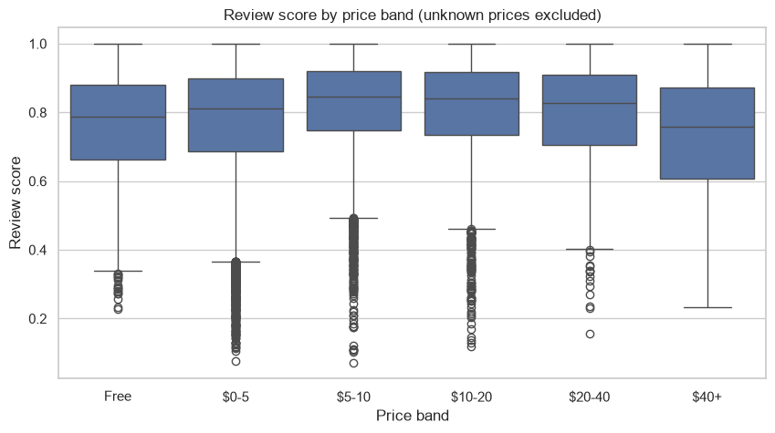
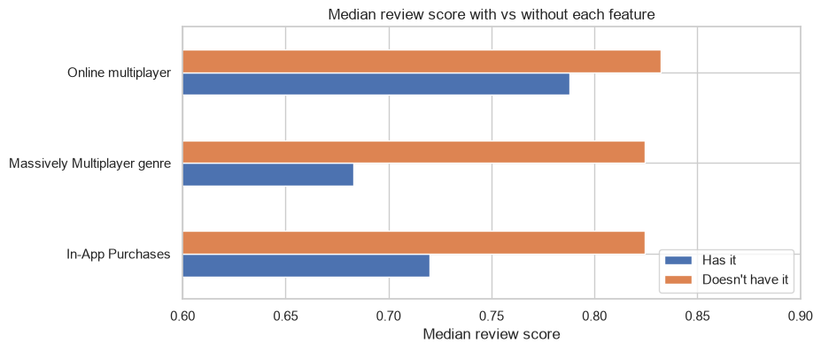
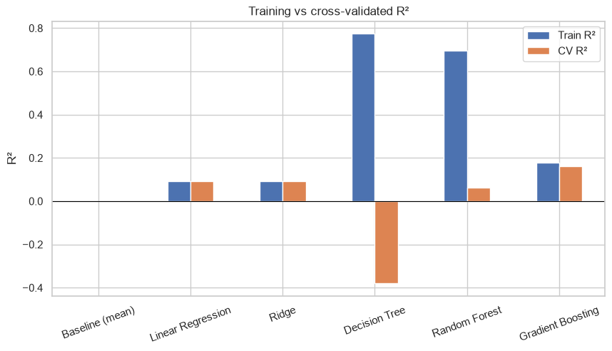
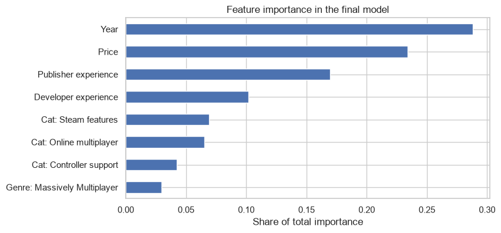

# What Makes Players Like a Steam Game?

An end-to-end data science project on 125,855 Steam games: cleaning a messy real-world dataset, finding which **pre-release decisions** are linked to how players review a game, and training regression models to predict the review score.

Course project for *Fundamentals of Data Science (CT-368)*, 5th semester, Fall 2026.

## The question

Steam hosts over 100,000 games, and outcomes vary enormously. Developers decide a game's price, genre, platforms, languages and release date long before players see it. **Which of those decisions are linked to better reviews?**

- **Target:** `Review score` = positive reviews ÷ total reviews, a value between 0 and 1. This makes it a **regression** problem.
- **Population:** games with at least 50 reviews, so every score is based on enough reviews to be reliable.
- **Features:** only information known **before release**. Owners, playtime, recommendations and player tags are excluded, because they are driven by the same success the target measures and would leak the answer.

## Key findings

**Mid-priced games score best.** Games priced 5–20 USD have the highest median scores (about 0.84). Free games, cheap games and games above 40 USD score lower.



**Monetised online games score lower.** Games with in-app purchases have a median score of 0.720 against 0.824 without; Massively Multiplayer games 0.683 against 0.824.



**Other findings**
- Review scores on Steam are skewed high: the median game scores 0.82, and only 5.9% score below 0.50.
- Ownership is extremely concentrated: 60% of all games have at most 20,000 owners, and only 4 exceed 100 million.
- 70% of the catalog is labelled Indie.
- Release month makes no difference to review scores.

## Results

Five models were compared with 5-fold cross-validation on the training set. The two tree ensembles were then tuned with `RandomizedSearchCV`, and the best model was evaluated **once** on a held-out test set of 6,012 games.

| Model | CV MAE | CV R² |
|---|---|---|
| Baseline (always predicts the mean) | 0.1225 | 0.000 |
| Linear Regression | 0.1161 | 0.091 |
| Ridge | 0.1161 | 0.091 |
| Decision Tree | 0.1369 | −0.380 |
| Random Forest, tuned | 0.1099 | 0.172 |
| **Gradient Boosting, tuned** | **0.1083** | **0.194** |

**Final model on the test set:** tuned Gradient Boosting, with **MAE 0.111** and **R² 0.157**, against MAE 0.122 and R² 0 for the baseline.



The default Decision Tree and Random Forest memorise the training games: high training scores, poor cross-validated scores. The linear models underfit, because the relationships are not straight lines, as the price sweet spot shows.

### What the R² means

Pre-release decisions explain about **16%** of the variation in review scores. That is expected: the biggest driver of reviews, how good the game actually is, cannot be known before release. The model clearly beats guessing, and it shows which decisions matter most.



Release year, price, and the experience of the publisher and developer carry about 80% of the model's importance.

## What the project covers

**Data cleaning** (Phase 1)
- Fixed a broken CSV header: 39 column names for 40 values per row.
- Removed duplicate store listings of the same game, keeping the most-reviewed listing per name and developer.
- Treated price 0 on paid games that are no longer sold as unknown, with a flag, instead of as free.
- Parsed language lists stored as text, including one malformed value.
- Removed non-game software, and grouped Steam's 58 overlapping categories into 10 flags.

**Preprocessing** (all fitted on the training set only)
- Median imputation for unknown prices, log transforms for skewed counts, one-hot encoding of release month, and standard scaling.
- Developer and publisher names turned into experience counts: how many other games the same studio has in the training set.

**Feature selection:** three methods, with data-driven stopping rules:
- **Filter:** mutual information, with random-noise columns as the threshold.
- **Embedded:** Lasso, using the one-standard-error rule.
- **Wrapper:** recursive feature elimination, using the one-standard-error rule.

The 8 features chosen by all three were kept.

**Modelling** (Phase 2)
- Linear Regression, Ridge, Decision Tree, Random Forest and Gradient Boosting, compared with 5-fold cross-validation.
- Hyperparameter tuning, and a single final evaluation on the untouched test set.

## Limitations

- The quality of the game itself is not in the data, which caps how much any model can explain.
- Only games with 50+ reviews are included, so the results describe games that reached some players.
- The findings are relationships, not causes.
- Developer and publisher experience counts include each studio's later games, so they partly reflect future success, not only experience at release.
- Preprocessing was fitted once on the training set before cross-validation, so cross-validated scores may be very slightly optimistic. A scikit-learn `Pipeline` would remove this.

## Repository contents

| File | Description |
|---|---|
| `steam_games_analysis.ipynb` | The full notebook: data understanding, cleaning, preprocessing, feature selection, modelling and evaluation |
| `project_report.pdf` | The written project report |
| `steam_games_cleaned.csv` | The cleaned dataset, 30,060 games × 39 columns |
| `images/` | Charts used in this README |
| `requirements.txt` | Python packages and the versions used |

The raw dataset is **not included**, because it is about 400 MB, over GitHub's file size limit.

## How to run

1. Download `games.csv` from the [Steam Games Dataset on Kaggle](https://www.kaggle.com/datasets/fronkongames/steam-games-dataset).
2. Rename it to `steam_games_raw.csv` and place it next to the notebook.
3. Install the requirements:
   ```bash
   pip install -r requirements.txt
   ```
4. Open `steam_games_analysis.ipynb` and run all cells. The full run takes a few minutes; the hyperparameter search is the slowest part.

## Data source

FronkonGames, *Steam Games Dataset*, Kaggle: https://www.kaggle.com/datasets/fronkongames/steam-games-dataset

## Author

Maaz Ahmed Khan
